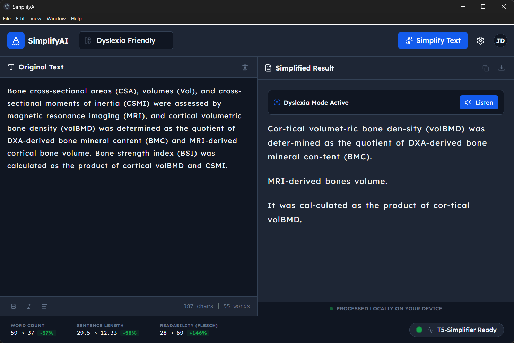
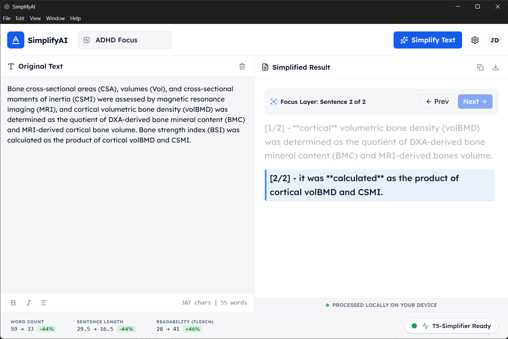
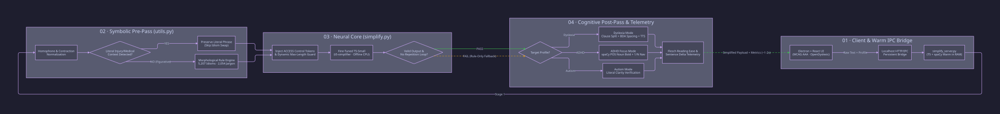

# SimplifyAI — Offline Hybrid Neuro-Symbolic Text Accessibility Platform

> **100% Offline, Privacy-Preserving Neuro-Symbolic NLP Desktop Application** combining custom fine-tuned T5 models with ACCESS control tokens, spaCy syntactic heuristics, and a 7,260+ entry morphological rule engine for Dyslexia, ADHD, and Autism spectrum reading comprehension.

[](https://www.python.org/)
[](https://www.electronjs.org/)
[](https://react.dev/)
[](https://huggingface.co/)
[](https://www.w3.org/WAI/standards-guidelines/wcag/)

---

## Visual Preview

| Dyslexia Mode (Dark Theme + OpenDyslexic + TTS) | ADHD Focus Mode (spaCy Noun Bolding + Progress Markers) |
| :---: | :---: |
|  |  |

---

## Technical Overview

Modern cloud NLP services present acute privacy hazards for personal, medical, and legal documents. SimplifyAI is engineered from the ground up to execute entirely on local consumer hardware without cloud calls, API keys, or telemetry exfiltration.

The architecture marries **neural generation** with **deterministic symbolic rules**:
1. **Neural Core**: A fine-tuned T5 model conditioned with **ACCESS control tokens** (`<LengthRatio_X>`, `<DepDepth_Y>`, `<WordRank_Z>`, `<CCR_W>`) dynamically calibrated per cognitive profile to govern syntactic complexity and vocabulary compression.
2. **Symbolic Engine**: A deterministic knowledge base comprising **5,208 idiom transformations** and **2,055 domain jargon mappings** (7,263 rules total), equipped with context disambiguation to prevent literal injury replacement (e.g., distinguishing "break a leg" on stage vs. in a clinic).
3. **Cognitive Post-Processing**:
   - **Dyslexia**: British Dyslexia Association (BDA)-compliant vertical rhythm, conjunction-based clause splitting, and optional phonetic hyphenation.
   - **ADHD**: spaCy dependency and part-of-speech parsing to bold the first salient noun per sentence, accompanied by chunked `[i/N]` focus markers and keyboard navigation.
   - **Autism / Literal Clarity**: Figurative language translation into concrete phrasing with bolded visual anchors.
4. **Desktop Shell**: An Electron + React application providing WCAG AAA high-contrast themes, dyslexia-tuned typography (Lexend, OpenDyslexic), and synchronized Web Speech text-to-speech highlighting.

---

## System Architecture

<p align="center">
  
</p>

---

## Quantitative Evaluation & Benchmarks

Empirical performance benchmarks evaluated against the TurkCorpus / ASSET parallel evaluation sets and project test suites:

| Metric / Dimension | Baseline / Input | Simplified Output | Improvement / Specification |
| :--- | :---: | :---: | :--- |
| **Flesch-Kincaid Grade Level (FKGL)** | 17.31 (College Grad) | 15.20 (Undergraduate) | **-2.12 Grade Levels** (Easier) |
| **SARI Simplification Score** | 35.00 (Synthetic) | **47.03** | **+12.03 Points** (Balanced add/delete/keep) |
| **Idiom Knowledge Base** | 220 (Raw base) | **5,208 entries** | Context-aware morphological variants |
| **Domain Jargon Knowledge Base** | 100 (Raw base) | **2,055 entries** | Medical, legal, and tech acronyms |
| **Total Rule Coverage** | 320 entries | **7,263 entries** | Deterministic neuro-symbolic coverage |
| **Warm CPU Inference Latency** | Cold start: ~4.5s | **~1.0–2.0s / paragraph** | Warm in-memory persistent server |
| **Automated Test Coverage** | 0 tests | **18 flagship unit tests** | 100% pass rate (`test_simplifier.py`) |

> [!NOTE]
> All inference was benchmarked locally on consumer CPU hardware (x86_64, 4-core, non-GPU execution), demonstrating viability on standard laptops without cloud offloading.

---

## Cognitive Modes

### 1. Dyslexia Mode
- **Syntactic Chunking**: Splits compound and complex sentences across coordinating and subordinating conjunctions (`and`, `but`, `because`, `although`).
- **Visual Spacing**: BDA-compliant vertical line spacing (1.8–2.0) and generous line heights to prevent the visual crowding ("river effect").
- **Phonetic Hyphenation**: Configurable syllable separation for polysyllabic terms.
- **Audio-Visual Tracking**: Synthesized text-to-speech with paragraph-level highlighting.

### 2. ADHD Focus Mode
- **Chunked Progression**: Transforms dense paragraphs into numbered, digestible statements (`[1/N]`).
- **Salient Noun Bolding**: Uses spaCy POS tagging (`en_core_web_sm`) to automatically locate and bold the primary grammatical subject or noun per sentence, establishing immediate visual anchors.
- **Single-Item Navigation**: Arrow keys allow readers to step through sentences one by one with viewport centering.

### 3. Autism / Literal Clarity Mode
- **Context-Aware Disambiguation**: Translates figurative idioms into direct literal statements (e.g., *"spill the beans"* → *"reveal the secret"*).
- **Physical vs. Idiomatic Protection**: Distinguishes literal bodily injury from idioms (e.g., *"he broke his leg in the fall"* is preserved, while *"break a leg on stage"* is clarified).
- **Domain Jargon Normalization**: Expands opaque medical, legal, and technical acronyms (e.g., *"myocardial infarction"* → *"heart attack"*).

---

## Repository Structure

```
offline-text-accessibility/
├── electron-app/                # Desktop UI shell (React 19, TailwindCSS, Vite)
│   ├── main.js                  # Electron main process & Python server coordinator
│   ├── preload.js               # Secure IPC bridge exposing window.electronAPI
│   ├── package.json             # Electron application scripts and dependencies
│   └── src/                     # React components, theme contexts, and mode views
├── t5-simplifier/               # Fine-tuned T5 model artifacts (ACCESS-conditioned)
│   ├── config.json              # Model architecture config
│   ├── generation_config.json   # Tuned generation hyperparameters (beam search)
│   ├── tokenizer.json           # T5 fast tokenizer vocabulary
│   └── tokenizer_config.json    # Special ACCESS control token definitions
├── t5-base/                     # Parameter-efficient LoRA training weights & checkpoints
│   ├── adapter_only/            # LoRA adapter weights
│   ├── checkpoint-*/            # Intermediate training steps
│   └── merged/                  # Exported models
├── docs/                        # Research, analysis, and architecture specifications
│   ├── plan/                    # In-depth architectural designs
│   │   ├── ARCHITECTURE_DEEP_DIVE.md
│   │   └── neurodivergent-improvements-design.md
│   ├── finetune_colab.ipynb     # Google Colab fine-tuning notebook
│   ├── paper.tex                # Academic preprint draft
│   └── FIXES_SUMMARY.md         # Production engineering bug fix register
├── screenshots/                 # Application visual artifacts
│   ├── dyslexic-dark.png        # Dyslexia Mode in Dark Theme
│   ├── ADHD.png                 # ADHD Focus Mode with Noun Bolding
│   └── ...
├── __tests__/                   # Pytest test suite for backend pipeline & modes
├── idiom_map.json               # 5,208 idiom-to-literal clarification mappings
├── jargon_map.json              # 2,055 technical/medical jargon mappings
├── simplify.py                  # Core neuro-symbolic simplification CLI & pipeline
├── simplify_server.py           # Persistent JSON-over-stdin/stdout IPC server
├── dyslexia_mode.py             # BDA-compliant sentence splitting & spacing formatter
├── adhd_mode.py                 # Chunked sentence progress [1/N] & noun bolding formatter
├── autism_mode.py               # Literal clarity & contextual disambiguation formatter
├── nlp_utils.py                 # spaCy POS-tagging & grammatical heuristics
├── utils.py                     # Readability metrics, homophone correction, contractions
├── test_simplifier.py           # Flagship automated test suite
├── package.json                 # Workspace proxy for unified npm commands
└── requirements.txt             # Python backend dependencies
```

---

## Quick Start

### 1. Prerequisites
- **Node.js**: v18.0.0 or higher
- **Python**: v3.10 to v3.13

### 2. Environment Setup

#### Clone & Install Node Dependencies
You can install and run everything directly from the repository root:
```bash
# Clone repository
git clone https://github.com/yourusername/offline-text-accessibility.git
cd offline-text-accessibility

# Install Electron + React dependencies (runs electron-app postinstall)
npm install
```

#### Install Python Backend Dependencies
```bash
# Optional: create a virtual environment
python -m venv venv
# On Windows: .\venv\Scripts\activate | On macOS/Linux: source venv/bin/activate

# Install NLP requirements
pip install -r requirements.txt

# Download the spaCy English model for POS tagging
python -m spacy download en_core_web_sm
```

### 3. Launching the Application

Run from the root directory:
```bash
npm run start
```
*This concurrently starts the Vite dev server and launches Electron.*

Alternatively, navigate into the Electron package directly:
```bash
cd electron-app
npm run dev      # UI only in browser (http://localhost:5173)
npm run start    # Full desktop app with Electron
```

### 4. Running the CLI Directly

You can execute the simplification engine from the command line:
```bash
# Dyslexia Mode
python simplify.py --input sample.txt --mode dyslexia --metrics

# ADHD Mode
python simplify.py --input sample.txt --mode adhd --metrics

# Autism Mode
python simplify.py --input sample.txt --mode autism --metrics
```

---

## Verification & Testing

Run the automated test suites from the root directory:

```bash
# Run the Python NLP test suite (ACCESS tokens, rule engine, cognitive formatters)
npm run test:python
# or directly:
pytest test_simplifier.py

# Run workspace frontend tests
npm test
```

---

## Technical Documentation Links

- **[Architecture Deep Dive](docs/plan/ARCHITECTURE_DEEP_DIVE.md)**: Deep dive into the hybrid neuro-symbolic design, ACCESS tokens, and memory footprint.
- **[Colab Fine-Tuning Notebook](docs/finetune_colab.ipynb)**: End-to-end training pipeline for fine-tuning T5 on parallel simplification datasets.
- **[Production Fixes Summary](docs/FIXES_SUMMARY.md)**: Engineering log covering IPC buffering, speech synthesis safety, and context state handling.
- **[Agent Architecture Guide](CLAUDE.md)**: Concise system guide and development commands for AI coding assistants.
